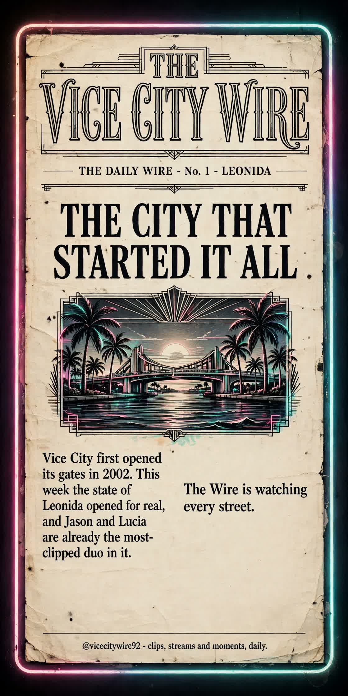
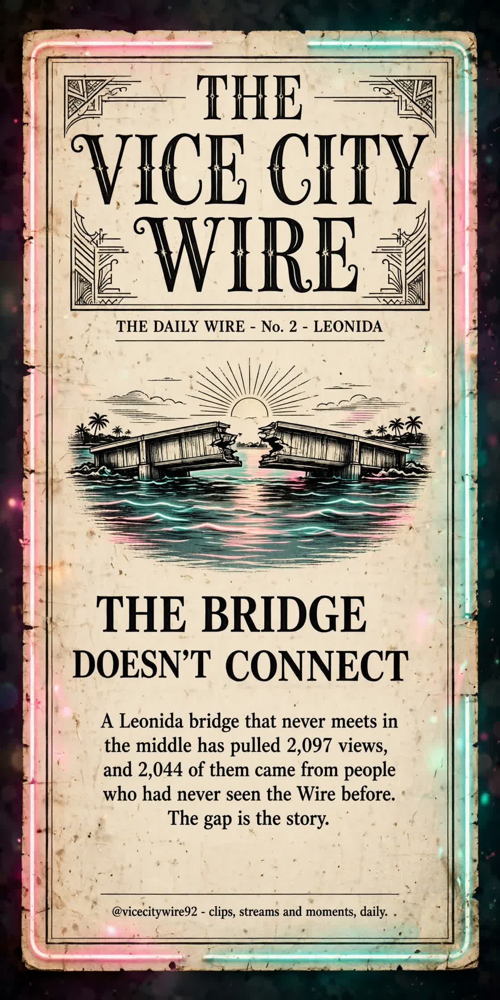
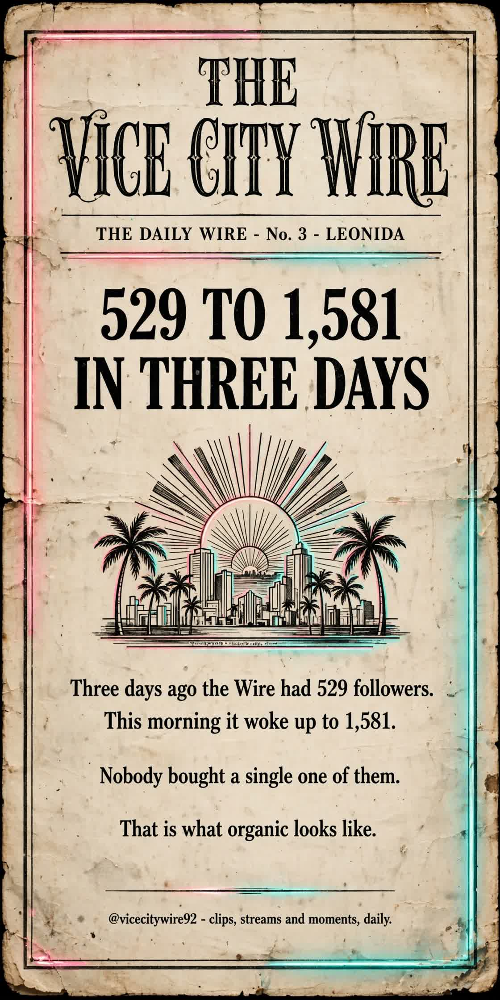
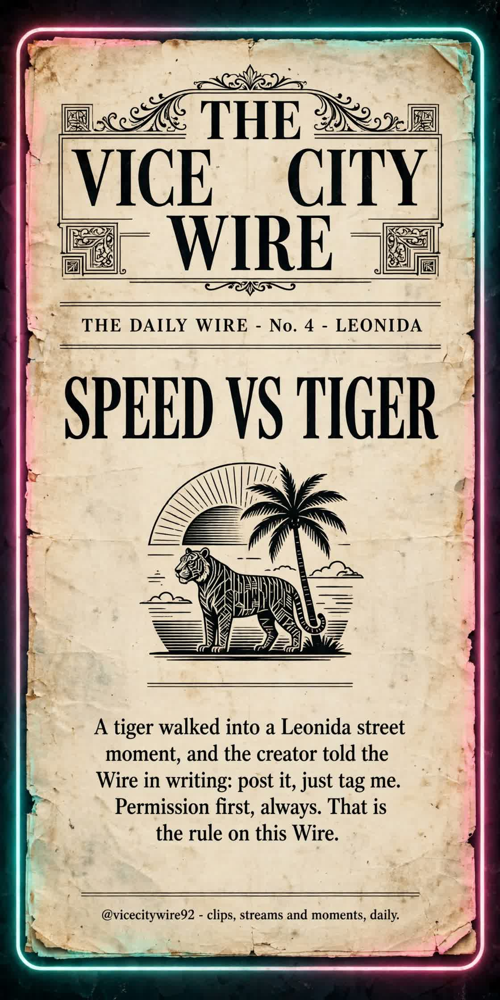
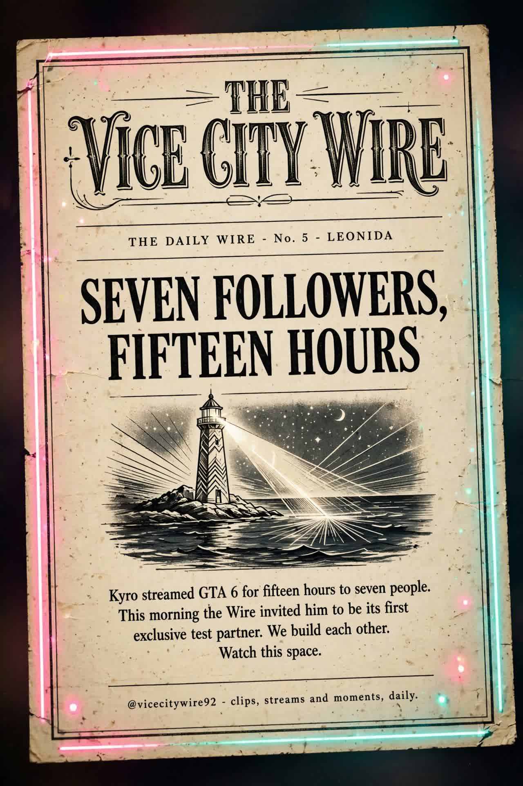
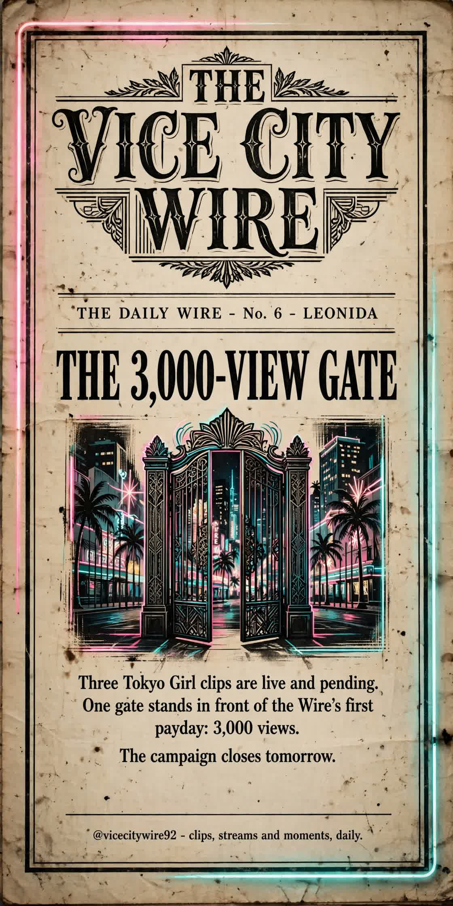
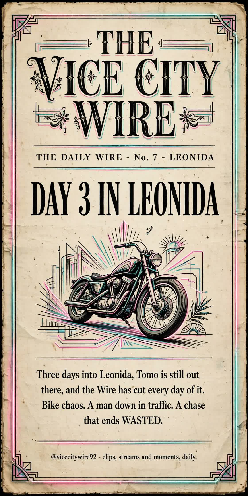
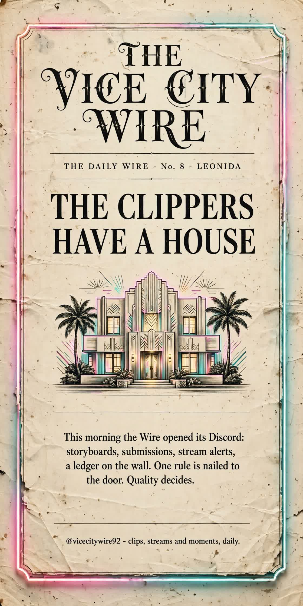
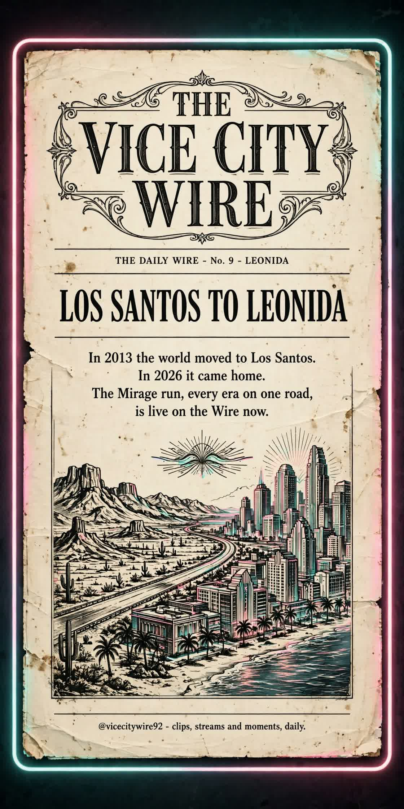

# THE DAILY WIRE — Vice City Wire's newspaper

**The Daily Wire** is the newspaper of **Vice City Wire** (@vicecitywire92): a numbered broadsheet card for every beat of the operation — launches, milestones, gates, and the people building the clipping world around GTA 6.

The newspaper is also the raw material of the **LIVE WIRE TICKET™**: a Daily Wire article becomes the face of a ticket, and the ticket live-wires straight into the reel. The paper reports it; the ticket hands it to you.

## The issues so far

| No. | Headline |
|---|---|
| 1 | THE CITY THAT STARTED IT ALL |
| 2 | THE BRIDGE DOESN'T CONNECT |
| 3 | 529 TO 1,581 IN THREE DAYS |
| 4 | SPEED VS TIGER |
| 5 | SEVEN FOLLOWERS, FIFTEEN HOURS |
| 6 | THE 3,000-VIEW GATE |
| 7 | DAY 3 IN LEONIDA |
| 8 | THE CLIPPERS HAVE A HOUSE |
| 9 | LOS SANTOS TO LEONIDA |

## The format

See [FORMAT.md](FORMAT.md) for how an issue is built — and how an issue becomes a ticket.

**It's live — you just replace the outer reel.** The full template package (frame, pieces, schemes, all formats, and the plug-in contract) lives in [template/](template/); see [template/PLUG-IN.md](template/PLUG-IN.md) for how pieces sit in and plug in.

## License

Covered under the house licensing framework — see [LICENSE](LICENSE). The designs are licensed, never sold; use requires written permission. Ownership: Bumkus.
